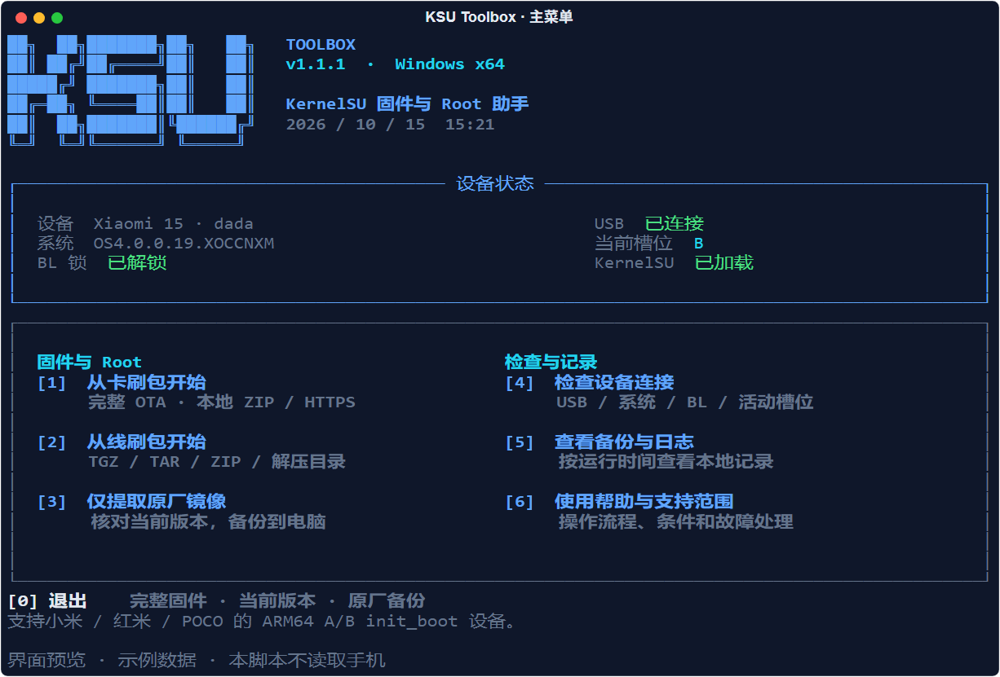
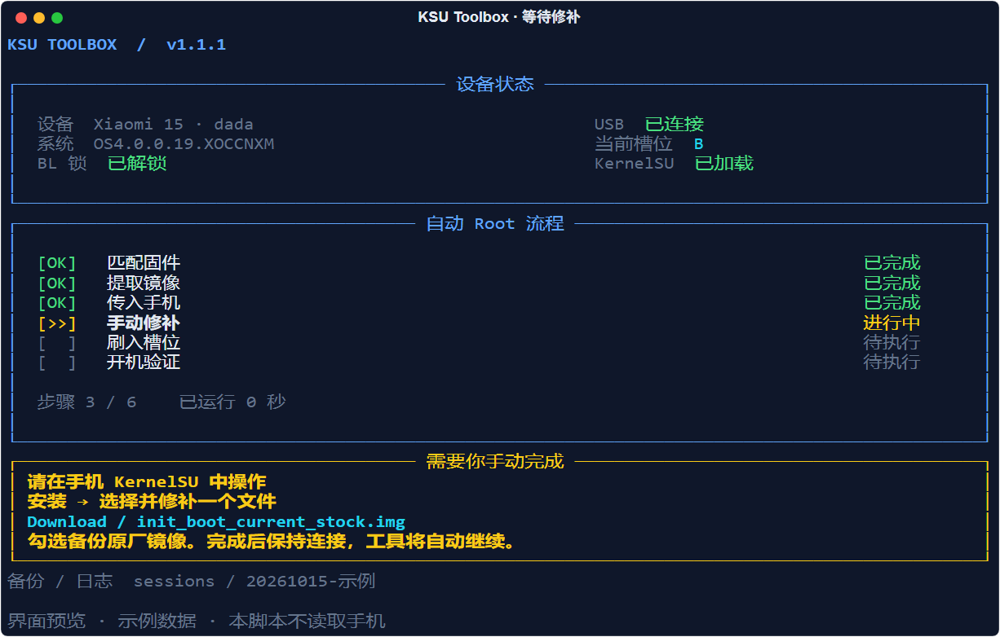

# KSU Toolbox

**Windows 命令行固件与 Root 助手 · v1.1.1**

[下载 Windows 便携版](https://github.com/Leonis-Q-F/KSU-Toolbox/releases/latest) · [提交问题](https://github.com/Leonis-Q-F/KSU-Toolbox/issues) · [版本记录](CHANGELOG.md)

为小米、红米和 POCO 的部分 A/B 设备提供完整固件提取、版本核对、原厂备份和 KernelSU LKM 安装流程。支持数字菜单，也支持命令行参数。



## 功能

- 卡刷包：本地完整 OTA ZIP 或 HTTPS 链接，远程包按需读取所需数据。
- 线刷包：本地 TGZ/TAR/ZIP 或解压目录，不运行整包刷机脚本。
- 读取手机状态，核对机型、内部构建号、安全补丁和活动槽位。
- 提取并备份原厂 `init_boot.img`，校验后传入手机下载目录。
- 用户在 KernelSU 手动修补，工具检测新结果并校验，自动刷入活动槽位。
- 六步进度、设备诊断、备份浏览、日志与恢复说明。

## 开始使用

1. 在 [Releases](https://github.com/Leonis-Q-F/KSU-Toolbox/releases/latest) 下载 `KSU-Toolbox-v1.1.1-windows-x64.zip`，完整解压，不需要安装 Python。
2. 保持随包的 `platform-tools` 文件夹完整。仓库、源码 ZIP 和 Windows 便携包均已包含固定版本的 ADB/Fastboot，无需另行安装或配置 PATH；可用 `--tools` 指定自己的版本。
3. 手机正常开机、BL 已解锁、启用 USB 调试，连接电脑并允许授权。
4. 双击 `ksu-root.cmd`。先选择 **仅提取原厂镜像** 可以检查版本和备份，不会刷写。

随包集成官方 Platform-Tools 37.0.1 的 ADB/Fastboot 最小运行集，包括所需 DLL、完整 NOTICE、版本与 SHA-256 记录。来源见 [platform-tools/README.md](platform-tools/README.md)。KernelSU APK 和手机固件需自行准备。ADB 工具集不替代 Windows USB 驱动或手机调试授权。

| 菜单 | 操作 |
|---|---|
| 1 | 从完整卡刷包开始 Root 流程 |
| 2 | 从线刷包开始 Root 流程 |
| 3 | 选择包类型，仅核对并提取到电脑 |
| 4 | 只读检查设备连接、系统、BL 和槽位 |
| 5 | 查看最近的本地备份和日志记录 |
| 6 | 查看帮助与支持范围 |
| 0 | 退出 |

无手机也可打开菜单和帮助。窄窗口使用单列布局，`--plain` 禁用彩色和动态刷新。

## 自动 Root 流程

```text
匹配固件 → 提取镜像 → 传入手机 → 手动修补 → 刷入槽位 → 开机验证
```

工具将带本次标识的 `init_boot_…_stock.img` 传到手机 `Download`。打开官方 KernelSU 管理器，确认受支持，选择 **安装 → 选择并修补一个文件**，选择刚传入的原厂镜像。可勾选“备份为原厂镜像”。



修补完成后保持连接。工具检测新文件、等待写入稳定、核对传输哈希、原厂 SHA-1、原始 init 和已知 KernelSU 布局。通过后自动进入 Fastboot，再次检查机型、BL、槽位和分区大小，刷入该槽位的 `init_boot`，重启并等待 KernelSU 模块达到 Live。

**选择 Root 流程后，新修补镜像通过校验即自动继续刷写。** 提前备份重要数据，刷写期间保持连接；不要在管理器选择“直接安装”或“安装到另一个槽位”。旧修补文件、版本不匹配和未知布局都会被拒绝。

## 参数调用

```cmd
ksu-root.cmd --type ota "https://服务器/当前版本完整卡刷包.zip"
ksu-root.cmd --type ota "F:\ROM\当前版本完整卡刷包.zip"
ksu-root.cmd --type fastboot "F:\ROM\当前版本线刷包.tgz"
ksu-root.cmd --type fastboot "F:\ROM\线刷包解压目录"

rem 只提取到电脑，不传输、不重启、不刷写
ksu-root.cmd --type ota --check "F:\ROM\完整包.zip"

rem 只提取并传入手机
ksu-root.cmd --type ota --prepare-only "F:\ROM\完整包.zip"

ksu-root.cmd --tools "C:\platform-tools" --serial 手机序列号 --type ota --check "F:\ROM\完整包.zip"
ksu-root.cmd --menu
ksu-root.cmd --help
```

另有 `--output`（备份目录）、`--timeout`（等待修补秒数，默认 1800）、`--plain`。脚本调用可直接运行 EXE，或设置 `KSU_NO_PAUSE=1` 避免 CMD 结束暂停。

`--prepare-only` 不提供断点续传。若之后要自动刷入，应重新运行并生成本次新修补结果。

## 支持范围

当前限定 Windows x64、小米/红米/POCO、BL 已解锁、ARM64、A/B 槽位、v4 `init_boot`，仅接受官方 KernelSU LKM 已验证布局，包括 v3.3.1 默认 `ksu_config`（`bundled=1`）。

卡刷包必须是当前系统完整 OTA，含唯一的 Android metadata 和未再次压缩的 `payload.bin`。支持 REPLACE、REPLACE_BZ、REPLACE_XZ、ZERO；增量 OTA 或未知操作会停止。

线刷包必须含同一目录下的 `misc.txt` 和 `images/init_boot.img`。TGZ 需要顺序扫描，可能耗时数分钟。远程线刷包先下载到本机。

完整 OTA 核对数据块和最终分区 SHA-256，线刷包核对版本并记录镜像哈希；**本工具不验证整包厂商签名**。请选择可信来源。当前不支持 Magisk/APatch/GKI、独立 IMG 或需要修补 `boot` 的老设备。

## 备份与恢复

每次运行在 `sessions/时间-标识/` 保存原厂镜像、修补结果、校验记录、日志和 `恢复说明.txt`。恢复说明仅针对本次同一系统与槽位；不要用旧备份恢复升级后的系统。

工具经过只读实机检查和模拟 USB 完整流程测试。初始手动流程在 Xiaomi 15 (`dada`) 上成功，不能据此声称所有符合条件的机型均已实刷验证。详细边界见 [支持说明](docs/support.md)。

日志含序列号、来源链接和本地路径，公开报告问题前先脱敏，参见 [SECURITY.md](SECURITY.md)。

## 开发和构建

Python 3.10+。源码可直接运行；Windows EXE 构建需要 Windows x64。

```cmd
python -m pip install -r requirements-dev.txt
python -m unittest discover -s tests -v
python src\cli.py --menu
python tools\build.py --output dist
```

构建先运行测试并校验随仓库的工具文件，再生成 EXE、Windows ZIP、源码 ZIP 和 SHA-256。产物使用明确清单，仅包含已固定的 ADB/Fastboot 运行集，排除 `sessions`、固件、未列明的程序、缓存和本地环境。重复构建请指定新的输出目录。

源码运行仍需 Python 与 `requirements.txt` 依赖；`ksu-root.cmd` 在源码目录下自动调用 Python，在便携包中优先调用 EXE。便携包不需要安装 Python。克隆仓库即可获得 ADB/Fastboot 文件，不使用 Git LFS 或子模块。

维护者可用 `python tools/platform_tools.py --archive 官方ZIP路径` 重建内置工具；不传 `--archive` 时从固定的 Google URL 下载并核对预设归档哈希。正常启动、测试和打包均无需联网下载 ADB。升级版本需审核并更新维护脚本中的固定版本和归档哈希。

GitHub Actions 包含 Windows / Python 3.10、3.13 测试，以及手动或版本标签触发的打包。工作流仅上传产物，不自动发布仓库或 Release。

`src` 为实现，`tests` 为合成镜像与模拟 USB 测试，`tools` 为构建/打包/预览脚本，`docs` 为说明与预览。可选真实镜像测试只从本机环境变量读取，样本不分发。参见 [贡献说明](CONTRIBUTING.md)。

## 许可与致谢

项目使用 [MIT](LICENSE)，依赖保留原始许可，见 [THIRD_PARTY.md](THIRD_PARTY.md)。

参考：[KernelSU](https://github.com/tiann/KernelSU)、[安装指南](https://kernelsu.org/zh_CN/guide/installation.html)、[Android Platform-Tools](https://developer.android.com/tools/releases/platform-tools)。本项目为独立工具，与 Xiaomi、Google、KernelSU 官方团队无隶属关系。
